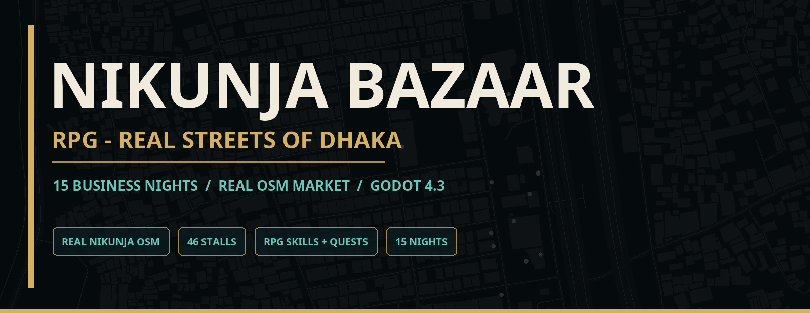
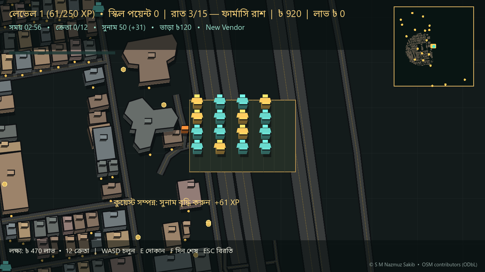
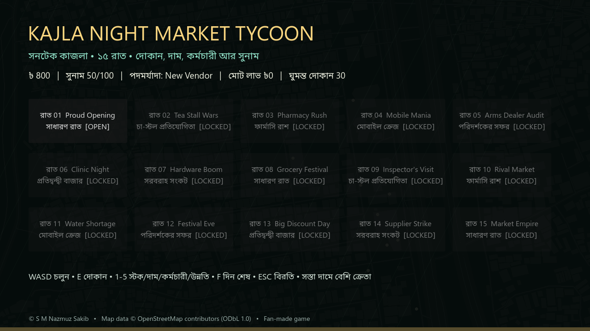
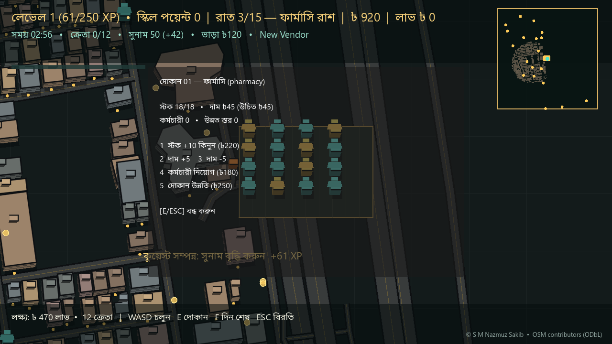
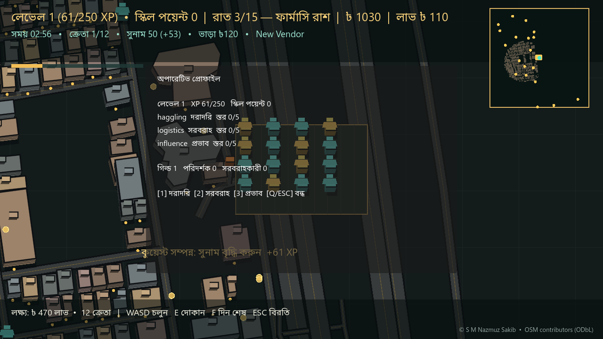
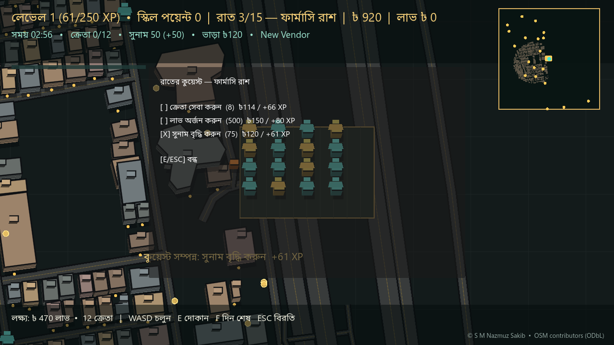
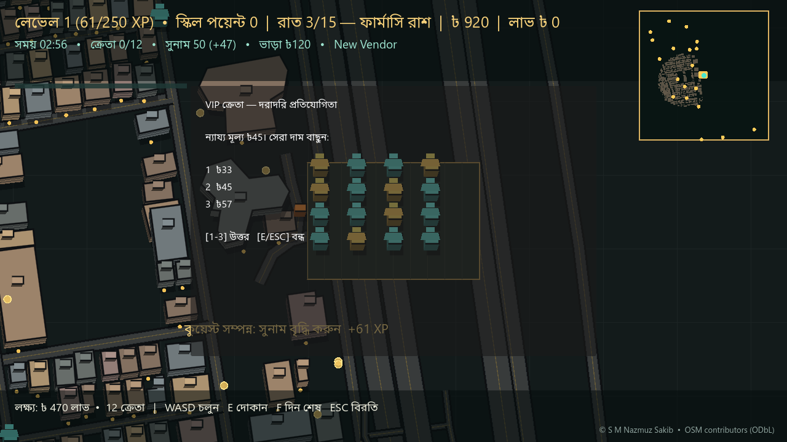
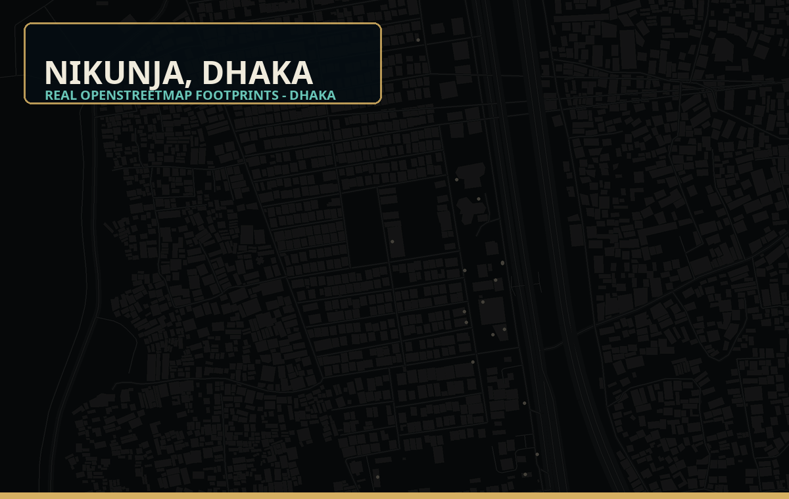
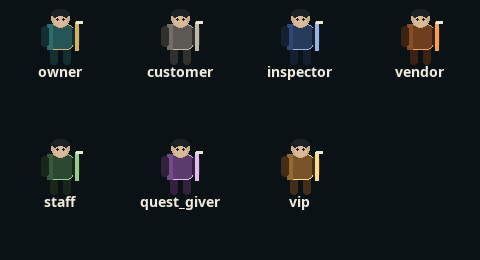

# Nikunja Bazaar RPG

[](https://github.com/Sakibpedia/nikunja-bazaar-rpg/actions/workflows/build_exes.yml)



A **2.5D market RPG built on the real streets of Nikunja, Dhaka.** Run stalls, trade with customers, earn XP, level up, spend skill points, complete quests and grow a bazaar across 15 nights. Godot 4.3.



## Play

Download `NikunjaBazaar.exe` from the [Releases page](https://github.com/Sakibpedia/nikunja-bazaar-rpg/releases) and double-click it. If SmartScreen warns, choose **More info → Run anyway** (the build is unsigned).

## Real urban data

The playable area is generated from an OpenStreetMap extract of **Nikunja, Khilkhet, Dhaka** (bounding box 23.8202–23.8402 N, 90.4078–90.4278 E):

- **362 real roads** — Kuril Flyover, Airport Road, Kabi Faruqi Sarani, Progress Sarani, Front Road, Sector Roads 1–16, residential lanes and service roads. Road widths come from OSM highway classes.
- **6,535 building footprints** (1,500 nearest used for collision; 600 drawn for GPU efficiency).
- **31 real amenities** — mosques, fuel stations, hospital, bus stations, ATMs, restaurants.
- Shops are placed along **named roads**, and the market plaza is found in a genuine open block.

Regenerate the map with `python tools/build_nikunja_map.py` from `assets/maps/nikunja_overpass.json`.

## RPG systems

- **XP & levels:** earn XP from sales, quests and completing nights; each level grants a skill point.
- **Skills:** `haggling` (better prices), `logistics` (more stock capacity), `influence` (smaller inspector fines). Max level 5 each.
- **Quests:** every night has three quests (serve customers, earn profit, raise reputation) with money and XP rewards.
- **Quest giver & VIP customer** in the plaza: open quests with `E`, or haggle with the VIP for bonus XP.
- **Factions:** guild, inspectors and suppliers track your standing.
- Persistent progression in `user://nikunja_bazaar.cfg`.

## Screenshots (rendered from the running game)

| Menu | Market plaza | Stall management |
|---|---|---|
|  |  |  |

| RPG skills | Quests | Haggling duel |
|---|---|---|
|  |  |  |

| Night summary | Real OSM map | Sprites |
|---|---|---|
|  |  |  |

## Controls

```
WASD / arrows walk      Shift sprint      E stall / quest giver / VIP
1 buy stock (stall)     2 price +5        3 price -5        4 hire staff   5 upgrade
Q RPG skills            F end night        ESC pause / close panel
RPG panel: 1-3 allocate skill   Quest panel: E/ESC close   Duel: 1-3 choose price
Summary: R retry, N next night, M menu
```

## Build and test

```powershell
python tools/build_nikunja_map.py
python tools/make_visuals.py
godot --headless --path . --import
godot --headless --path . res://tools/test/CityTest.tscn
godot --headless --path . res://tools/test/EconomyTest.tscn
powershell tools/test/run_all.ps1 -Godot "C:\path\to\Godot_v4.3-stable_win64_console.exe"
godot --headless --path . --export-release "Windows Desktop"
```

All tests print `PASS`. Full results: [docs/VERIFICATION.md](docs/VERIFICATION.md).

## Credits

**Made by S M Nazmuz Sakib.** Game design, code and generated art are by S M Nazmuz Sakib.
Map data © [OpenStreetMap contributors](https://www.openstreetmap.org/copyright), ODbL 1.0.
Fonts: Noto Sans / Noto Sans Bengali (SIL OFL 1.1).
No open-source license is granted for the original work.
